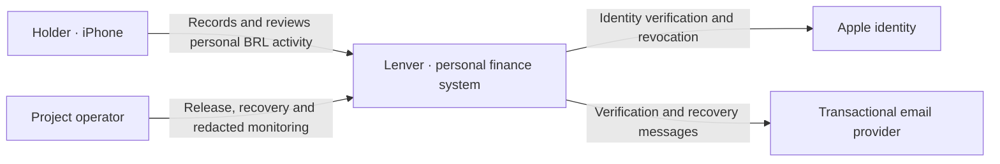
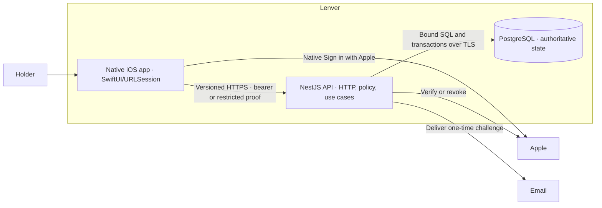

# Architecture and system design

## Baseline and transition

| Boundary | Observed at the local revision | Target and transition |
| --- | --- | --- |
| iOS `91dde88` at start | Native SwiftUI/URLSession, separate account/auth code and Keychain. Existing Release targets production; the prior staging switch and MVP opt-in were Debug-only. | `StagingRelease` adds a separate bundle ID and Keychain service and requires an HTTPS staging URL. Its authenticated screen exposes no transaction/account flow. Production Release behavior stays as before. No actual staging host or signing profile is supplied. |
| API `e5b0804` at start | NestJS modular monolith, Express, `pg`, auth/accounts/transactions modules, current unversioned and `/mvp` routes. `/health` is process health. | V0 adds `/ready`, which checks PostgreSQL access and exact schema marker `20261126_v0`; errors are generic. `/v1` migration, verified email authority and deletion are not implemented here. |
| PostgreSQL / I1–I5 | `db.sql` bootstrap and historical SQL migrations. Ownership tuples, idempotency receipts, account revision, dated checks, expense recovery, audit and opening-base versions are present. Runtime/migrator roles and deployed schema are not evidenced. | Reuse the existing schema and I1–I5 investments. The V0 marker is additive. Coordinate every writer before relying on a holder-wide lifecycle fence; V0 does not activate that protocol. |
| Runtime | Node 24.22.2 and PostgreSQL 16.14 were used locally. The accepted V0.1 manifest records Docker Engine 29.5.3 and `node:24-alpine` runtime Node `v24.22.3`. REN01 changes the Docker install step to `npm ci`; its post-change image build remains unverified because the current Docker daemon is inaccessible. | Keep Node 24 and PostgreSQL 16; preserve the accepted V0.1 evidence and distinguish it from the later Dockerfile change. Provider selection, grants and live deployment remain separate gates. |
| Docs `2a6cea9` at start | Approved domain package plus ADR 0001–0006. Historical handoffs provide examples, not current release evidence. | ENG01 v1.0 records approved architecture, open conditions, reproducible V0 checks and remaining gates. |

I1 brings explicit base and registration. I2 supplies dated observation and frozen comparison. I3 brings retroactive recovery, I4 auditable corrections and check succession, and I5 suspension/correction of opening balance. This baseline preserves them. Existing I5 mechanisms do not prove that every API writer shares the same lifecycle fence. Known follow-up gaps remain: intent behavior across all writers, authorized search/filter contract, and IF-13 tie-break compatibility. Render, Neon and Resend are candidates only. Source, readiness, provider names and a local disposable database do not prove a deployed environment. Pair deployment identity, runtime/migrator grants and live schema before promotion.

[Backend source](https://github.com/lenver-hq/lenver-backend/tree/e5b0804de1c7fce1478e153e08269701a21161fe) · [iOS source](https://github.com/lenver-hq/lenver-ios/tree/91dde88c77d72e0b3061b2f2f2013f2901e394b0) · [Functional modeling](https://github.com/lenver-hq/lenver-docs/tree/2a6cea91ffe2ff516394324929542f77b63e43af/domain)

## C4 system context

## C4 containers and API components

Within the API, HTTP controllers validate the DTO and resolve identity. The authority policy determines permitted method, scope and lifecycle. Financial query services produce revision-bound snapshots and never call command handlers. Account command services coordinate intent/receipt, revision, financial facts and audit in one commit. Identity lifecycle and provider adapters own challenges, sessions and asynchronous deletion consequences. The deletion runner consumes durable status/job records using bounded leases, idempotent steps and lost-worker recovery. Routine queries need neither remote Apple calls nor a separate service. Use the same deployable initially, with an independently scoped operator path where needed. Implement a new service only if isolation or measured workload requires it. [C4 model diagram guidance](https://c4model.com/diagrams).

## Deployment and recovery topology

```mermaid
flowchart TB
    subgraph E1["Local and CI · synthetic"]
      S["Disposable iOS target / controlled transport"] --> LT["API + isolated PostgreSQL 16 fixture"]
    end
    subgraph E2["Authorized staging · synthetic"]
      P["Physical iPhone Release candidate"] -->|"HTTPS"| SA["Staging API + provider sandbox"]
      SA -->|"TLS"| SD[("Staging database")]
      SM["Scoped migrator"] --> SD
    end
    subgraph E3["Distribution candidate · promotion gated"]
      R["Signed Release iPhone"] -->|"Canonical HTTPS host"| PA["API + bounded maintenance runner"]
      PA -->|"TLS / runtime role"| PD[("Managed PostgreSQL")]
      PU["Separate migrator/operator"] -->|"Scoped transport/roles"| PD
      PD -->|"Backup / restore history"| B[("Restricted recovery sources")]
      PA -->|"Minimized lifecycle checkpoint"| K[("Independent recovery evidence")]
      B --> RI["Isolated restore and reconciliation"]
      K --> RI
    end
```

Attach to each promotion an iOS build and configuration, API source/image and runtime version, schema identifier plus checksums, test fixture and provider/environment identifiers, and writer/read compatibility. Redacted liveness reports process uptime. Readiness uses a bounded, read-only runtime-role query plus expected schema/capability checks and generic errors. Keep external provider reachability family-specific. Node 24 is the selected local/image runtime; accepted V0.1 evidence verifies `node:24-alpine`, while REN01's later `npm ci` change still needs a Docker build/runtime rerun. Keep the PostgreSQL major unchanged initially unless the authorized target requires a separate rehearsal. Neither billing nor production configuration is inferred. [Node.js release lifecycle](https://nodejs.org/en/about/previous-releases).

## Capacity and operational viability

ER02 C1 at 10 requests/s for 30 minutes implies 18,000 attempted requests. C2 adds 6,000 at 20 requests/s and 9,000 at 30 requests/s, each for five minutes. Use 100 synthetic holders, 100,000 movements and a holder with 5,000 plus version/check/receipt fixtures. Report offered/served traffic, skew, response sizes, warm/cold, error and p50/p95/p99 separately by family. Hold one connection budget across API pools and maintenance; reserve migrator and operator slots. Start with a bounded pool, measure acquisition and hold times, locks, CPU/RSS, I/O, plans and WAL, then adjust. Example only: 10 req/s × 0.1 s mean DB hold = 1 executing connection in steady state, excluding burst, contention and operator work. Size from measured tails, never from that mean alone. A hypothetical 2 KiB per movement including proportional index overhead gives about 195 MiB for 100,000; actual heap, related versions/receipts, backups, WAL and egress must be profiled. Keep server filtering and stable pagination; add indexes only to support plans on representative data. No queue cluster, cache tier or materialized balance is required on present evidence. Use the ER02 saturation and demand triggers before scaling.

A single maintainer can run a small synthetic campaign and bounded pilot if responsibilities, backup responder, budget and escalation windows are approved. Assign engineering to integration, product to design/acceptance, operations to deploy and restore, and privacy to access, retention and incidents. A single owner may fill several roles; record who can independently review high-risk promotion and who can cover absences. Use milestones rather than continuous on-call promises. Provider pricing, SKU, region, legal/privacy profile, restore horizon and time capacity remain approval gates.

## Approved decision records and conditions

| Record | Decision and rationale | Alternatives and consequences | Acceptance / revisit |
| --- | --- | --- | --- |
| ENG01-ADR-A | Approved direction: native SwiftUI, modular NestJS monolith, PostgreSQL as source of truth. | Retain backend authority and exact-money design in ADRs 0001/0002. Keep one deployable initially; split only for an evidenced isolation or scaling need. | Direction accepted. Provider, region, pricing and infrastructure changes remain unauthorized. |
| ENG01-ADR-B | Approved direction: shared holder barrier, scope-bound intent and atomic effect/receipt. Intent-status lookup is strictly read-only. | Replacement applies only to an unresolved intent and requires a durable no-effect seal that fences late commands. After a confirmed terminal outcome, a later legitimate operation receives a new intent/generation and idempotency key; it does not replace the terminal intent. Keep anti-duplication evidence independently of receipt-payload retention. | Direction accepted. All writers, lock order, both race orders and lost-response behavior must be proven before affected flows. |
| ENG01-ADR-C | Approved direction: versioned API and gradual compatible migration using expand, verify, activate, contract. | Preserve stable identifiers and supported behavior. Do not mutate unversioned route semantics in place or create a permanent parallel stack. | Direction accepted. Current API remains OpenAPI `0.0.1` with mixed unversioned/`/mvp` paths; compatibility set and retirement plan remain to be implemented. |
| ENG01-ADR-D | Approved direction: coordinated deletion fence, auditable asynchronous completion and reconciled restore with no authority revival. | A restore with an unknown deletion or accepted effect stays unavailable until bounded and reconciled. | Direction accepted. Provider/checkpoint policy, two isolated restores, access grants and retention remain gates. |

## Approved policy parameters and unresolved conditions

| Topic | ENG01 v1.0 decision | Condition before implementation/promotion |
| --- | --- | --- |
| Identity | Verified email/password or Apple identity; never merge accounts automatically by email. | Verify email/password authority, Apple capabilities and session revocation on a physical Release candidate. |
| Proof/session | One-use recovery proof: 15 minutes; contextual reauthentication: at most 5 minutes; refresh idle expiry: at most 30 days. | Candidate values only; verify provider limits and approve a separate absolute session lifetime. |
| Retention | Raw telemetry 14 days; aggregate metrics 90 days; replay receipt 30 days; deletion-status lookup 30 days after definitive outcome; synthetic backups 7 days. | Candidate values only. Preserve the no-effect/terminal deduplication anchor independently of replay-payload retention. Inventory vendor copies and prove purge/reconciliation. |
| Hosting | Render, Neon and Resend remain candidates. | No purchase, region selection or infrastructure change is authorized by ENG01. |
| Gates | Design, security, Release, research and operational gates remain open until their own evidence exists. | React administration remains post-MVP and out of this delivery. |

## V0 result boundary

V0 adds reproducible clean bootstrap and a representative pre-I1 to I1–I5 upgrade against disposable PostgreSQL, an exact schema readiness check, a JSON provenance manifest, and an isolated `StagingRelease` build configuration. It does not deploy, migrate a real database, enable a finance journey, prove a signed/physical Release, establish production role grants, or close G02–G10. The test baseline and remaining evidence are enumerated in [Implementation and verification](delivery-and-verification.md).
