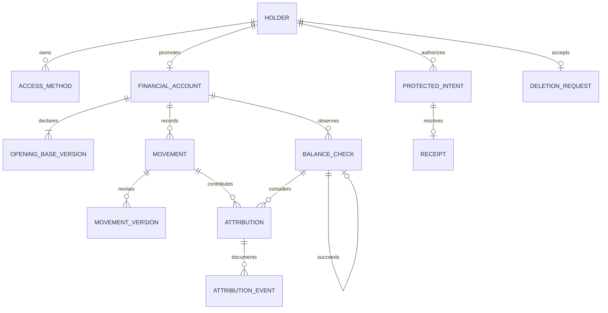
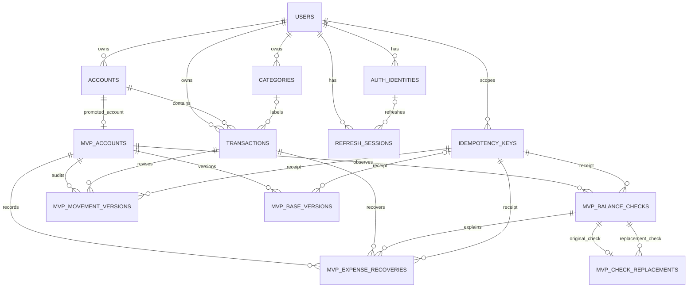
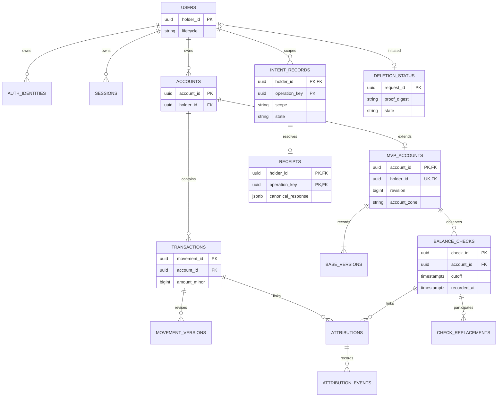
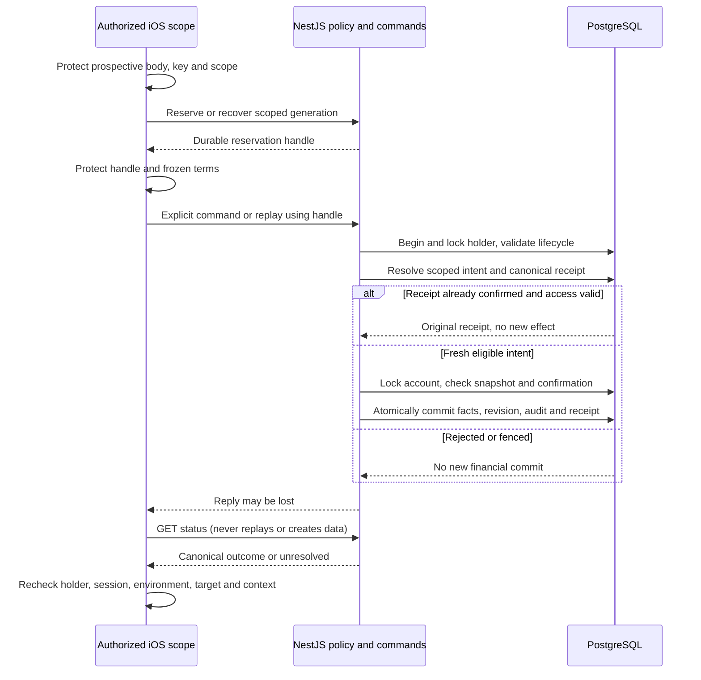
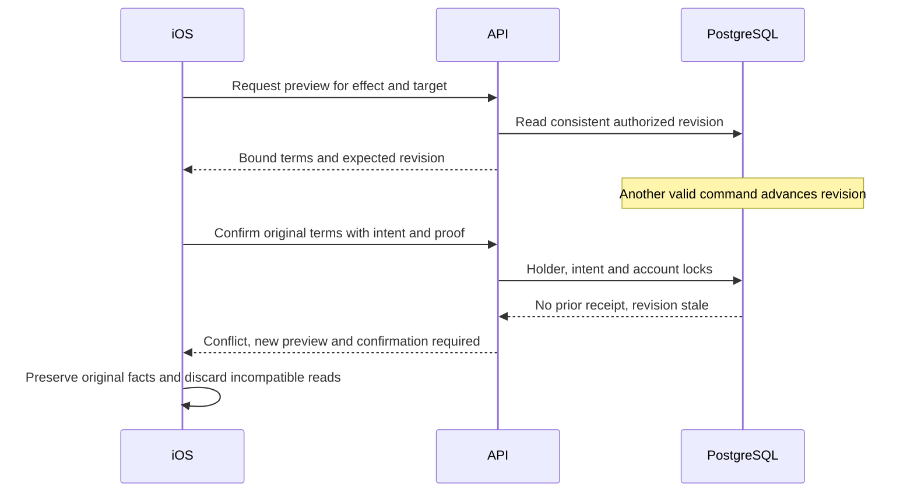

# Data and contracts

## Conceptual entity–relationship model

This is the approved target domain vocabulary, not a claim that each entity already has a physical table. Current and future storage are separated below.

Holder identity, financial account and access method have independent lifecycles. A check is an observation; it never creates a money movement. A movement can support different eligible check pairs after distinct decisions. One pair can have independent attribution events. Legacy financial accounts may exist outside the one promoted account. Deletion erases personal records under its lifecycle policy, including ordinary audit records where applicable.

## Implemented entity–relationship model (`lenver-backend/db.sql`)

This is the physical model present at V0. It intentionally excludes the future intent ledger, deletion request/status and independent recovery checkpoint: those tables do not exist in the current schema. `lenver_schema_version` is a single compatibility marker, not a migration ledger.

| Relation / invariant | Current schema enforcement |
| --- | --- |
| User to account/category/transaction | `user_id` FKs plus composite `(user_id, id)` and `(user_id, account_id, currency)` references prevent cross-owner or wrong-currency links. |
| User to promoted account | `mvp_accounts.user_id` is primary key; its composite FK binds the chosen account and BRL currency. A separate unique account constraint prevents promoting an account twice. |
| Apple identity and refresh session | Provider/subject and user/provider are unique. Refresh sessions bind the optional identity to the same user; identity reparenting is blocked. Deferred triggers require each user to retain a password or external identity. |
| Movement, check, recovery and audit | Composite owner/account FKs bind facts and versions to one promoted account. Checks and versions use revision uniqueness; recoveries uniquely bind check/movement and optional external reference. Replacement predecessor and successor IDs are unique and point to checks of the same user/account. |
| Idempotency | `(user_id, idempotency_key)` is unique. MVP movements, checks, recoveries and base changes link to that receipt key using deferred FKs; the existing table stores canonical response JSON. Current schema does not provide a separate unresolved-intent state machine. |
| Compatibility marker | `lenver_schema_version` enforces one singleton row and a bounded version string. The clean bootstrap and V0 migration set it to `20261126_v0`; it does not record migration hashes, execution identity or per-migration history. |

Source-to-schema verification is reproducible with `npm run verify:compatibility` in the backend. The upgrade fixture is pinned to pre-I1 commit `3d9460708100339774eba811e8c7f21510211cb8`; it is a synthetic database fixture, not proof about any deployed database.

## Target logical entity–relationship model (not implemented)

The target adds protected intents/receipts, deletion status and separately durable recovery evidence. These are design targets only; do not read their names below as current tables or delivered behavior. This diagram groups intended joins. The constraint table defines desired ownership, lifecycle exceptions and self-references.

| Rule | Enforce and verify |
| --- | --- |
| Ownership and access | Primary IDs remain stable. Composite unique keys and FKs on ownership tuples protect cross-account references. All queries scope by authenticated holder and target. Unique external provider/subject; no email merge. At most one promoted MVP account per holder. The holder can have zero before confirmed opening or adoption. Cleanup removes the holder link from final minimal status. Keep legacy category references and values. |
| Money | BRL throughout C+A. Movement amount positive 1–999,999,999 cents; type supplies sign. Base and stated amount are signed Int64, including explicit zero. Use PostgreSQL bigint for source cents, numeric integer for derived sums and differences. Sum/cast before subtraction and never convert to JS Number or truncate through Swift Int64 when decoding derived values. |
| Wire and client precision | Signed canonical base-10 integer strings for amounts, aggregates and revisions, with schema bounds and consumer validation per field. Parse base/informed into Swift Int64 with explicit errors. Keep wide server aggregates as canonical strings and format with integer string grouping/separation; no unbounded arithmetic on iOS and no floating fallback. Legacy number fields keep their prior contract. Unavailable values carry status with no amount. |
| Coverage and time | Store named account zone and original precision. An exact occurrence is an instant plus input offset where civil-time ambiguity applies. A civil day is the interval from its local start to next local start, end exclusive. Never add 24h to get the next local day. T0 and a check cutoff are inclusive for exact instants. A day-only occurrence is admitted only when every instant in that interval has the same membership at each relevant boundary and future-time guard. If the last eligible boundary touches the excluded end, classify by the half-open rule; an exact fact at the cutoff still belongs. Reject nonexistent time and require the offset for repeated local hour. Preserve original date and range when refining; track timezone database fixture/version. |
| Revision and snapshot | Serialize single-account commands; bind one authoritative revision and explicit query lineage to values. Select eligible effective versions under that revision. Balance = signed base + income − expense in covered window. Difference = calculated − declared. Distinguish current balance, frozen original, recalculated cut and residual. Use one transaction snapshot for multiple read statements or one consistent SQL statement. Suspended/absent base produces a distinct unavailable state; retain historical originals and suppress dependent writes. |
| Corrections | Immutable originals; append actor, target, source revision, server-assigned recordedAt from the committed row, reason, evidence class and effect. Real recovery inserts movement and link together. Unique account/source/reference where genuine reference exists, pair identity unique, active/effective relation revisioned. Withdrawal/restore changes attribution only, requires its own confirmed request and evidence for restoration. A replay returns the original receipt. Attributed re-opening requires proof of the prior attributed-zero episode. Zero coincidence and reversed residual are distinct. |
| Succession and most recent | Check replacement edges are same-account, one outgoing/incoming maximum and strictly increasing creation revision to prevent cycles; no inherited attribution. Preserve both edge reasons for A→B→C. IF-13 selects active checks by cutoff DESC, server recorded instant DESC, canonical stable ID ASC with deterministic ordering; selected unavailable recalculation stays selected. Empty confirmed result is separate from unavailable or unauthorized. |
| Atomicity | One database transaction commits effect, account revision, evidence/trail and canonical scoped receipt. Failed validation/timeout before commit leaves no financial effect. Externally stable receipt records a successful commit even if iOS reread fails. Transaction-level serialization is paired with constraints. |
| Exclusion | Authorize/recheck commit under stable holder guard before intent/receipt and account locks. Hold the same guard in identity/session transitions that alter write authority, account creation/adoption, every legacy/runtime writer and deletion acceptance. Acquire dependent locks in stable order, migrate the whole writer set before relying on the fence. Provider I/O outside database transactions. |

Attribution tests exercise nonzero original, exact proof contribution, partial same sign, unrelated zero, inverse sign and re-opening after each kind of zero. Independent check observations can share a cutoff without implying duplication. Money test cases include signed endpoints, explicit zero, one unit beyond limits, aggregate beyond Int64 and exact rendering in both locales. See RF-016–047, IF-10/12/13, RNF-01–07/16/17 and MF01.1 invariants. [PostgreSQL 16 locking](https://www.postgresql.org/docs/16/explicit-locking.html) · [PostgreSQL 16 numeric types](https://www.postgresql.org/docs/16/datatype-numeric.html).

## Target interfaces and versioning

Relative path names below are candidates for backend OpenAPI. The API owns schema and validation, iOS uses Foundation Codable and stable localized error mapping, and SQL constraints protect persisted state. Shape decisions are versioned independently of app marketing version and schema migration checksums. All successful finance reads identify the scope and revision. All commands get an application idempotency key for the logical intent, a frozen canonical payload and its type/target; preview confirmation includes expected revision, bound preview token, explicit confirmation and reason/reauth when required. Inputs are strictly validated. Errors carry stable code and opaque diagnostic correlation ID, with no financial or credential data in operational logs.

| Family | Established I1–I5 | Proposed official versioned boundary |
| --- | --- | --- |
| Identity | `/auth/register`, login, Apple/link, refresh, logout | `/v1/auth/…` plus verify/resend, recovery, authorized unlink, contextual proof and session lifecycle. Competing claims are exclusive in DB. Verified method and lifecycle determine financial authority. |
| Account / adoption | `GET/POST /mvp/account`, previews, legacy blocked | `/v1/account`, opening and adoption previews/commands. Return explicit missing, legacy blocked, active or suspended state. Opening or eligible adoption applies explicit base, T0 and zone without inventing facts. |
| Movements and history | `/mvp/transactions` and history cursor | `/v1/account/movements` with full authorized description search, exclusive type, civil-day period and cursor bound to scope, version, filters and ordering. Return page + cursor + revision. Cursor mismatch restarts authorized query. ID-addressable detail and original/versions. |
| Checks | Preview, write and listing | `/v1/account/checks` and previews, distinct original/current/residual and explicit IF-13 reference. Return separate predecessor/successor identities and reasons. |
| Recovery / corrections | Recovery and audit preview/confirm, base/movement versions | Separate eligibility/preview and confirm endpoints for link/recover, withdraw/restore, movement correction/invalidation, succession, base suspend/correct and temporal refinement. Preserve tested DTOs internally. No persistent financial effect on preview. |
| Protected resumption | Replay through original POST | Candidate `GET /v1/intents/{id}` for pure authorized status, original POST for explicit replay. Scope-bound registration and terminal no-effect semantics below. Read protects receipt and does not consume or renew authority. |
| Deletion | No route in observed OpenAPI | Candidate `POST /v1/deletions`, scoped reauth, stable request ID and protected proof recorded before sending. `202` only after the barrier and durable deletion job commit; pure `GET /v1/deletions/{id}` with restricted proof after session loss. Status has operation semantics and no finance access. |

## V0 writer, role, version and migration inventory

### Current write-capable surface

| Writer / entry point | Persisted scope | Compatibility and control observed |
| --- | --- | --- |
| iOS clients | Call API only; no direct database connection. | App marketing/build version is `1.0`/`1`; production Release is unchanged. `StagingRelease` has the fixed bundle ID `com.ferrari.Fintech.staging` and an endpoint-scoped Keychain namespace; it exposes no account/transaction view model. No production role or provider credential is embedded. |
| Auth controller: `POST /auth/register`, `/login`, `/apple`, `/apple/link`, `/refresh`, `/logout` | `users`, `auth_identities`, `refresh_sessions`. | Identity commands can change a holder's authority. Current schema enforces one password or Apple method and immutable Apple identity ownership. The approved shared holder barrier is not shown across every auth, finance and deletion writer. Email verification/recovery/unlink and deletion are absent from the current OpenAPI. |
| Legacy accounts: `POST /accounts` | `accounts`. | Legacy account creation remains separate from MVP promotion. It must join the future lifecycle fence before deletion or account-opening races are declared safe. |
| Legacy transactions: `POST /transactions` | `transactions`, `idempotency_keys`. | A database trigger rejects legacy transaction writes for an account once promoted to `mvp_accounts`; test covers this constraint. That trigger is not evidence that every future writer shares one holder lock. |
| MVP movements: `POST /mvp/transactions` | `transactions`, scoped idempotency receipt and account revision. | Receipt/revision constraints and account write fence exist. |
| MVP accounts/checks/recovery/audit: `POST /mvp/account`, `/mvp/checks`, `/mvp/recoveries`, `/mvp/audited-changes`; their `*-previews` endpoints are POST requests too. | `mvp_accounts`, checks, recoveries, movement/check/base history and receipts. | Treat preview HTTP verbs separately from effects; do not infer a write from POST alone. Harness verifies clean-schema invariants and I1–I5 data preservation, but not all two-connection races or a holder barrier across every command. |
| Migration operator | Direct SQL against the selected database. | Repository contains ordered SQL files but no application migration runner, schema-ledger table, separate migrator principal or grant setup. V0 harness uses `psql` only against its temporary local databases. |

The app/API runtime is configured with `DATABASE_URL` in the backend. No role creation or grants are present in `db.sql` or the reviewed migrations. Runtime read/write scope, separate migration credentials, TLS settings and actual hosting roles therefore remain unverified. The readiness query also requires runtime-role `SELECT` on `lenver_schema_version`; that grant is an explicit deployment prerequisite.

### Version and pairing matrix

| Component | Current identifier | V0 evidence | Current compatibility boundary |
| --- | --- | --- | --- |
| iOS client | App `1.0` build `1`; preserved bundle IDs `com.ferrari.Fintech` (production) and fixed `com.ferrari.Fintech.staging` (`StagingRelease`). | Source hash and Git revision in the preserved manifest; generic iOS staging build and Simulator tests are separate evidence. | No formal min/max API matrix. Production Release keeps its existing host and Keychain service. Staging uses a separate host input and fixed bundle ID; its Keychain service namespace appends the full endpoint, so it varies by endpoint and refuses the production host. REN01 preserves Apple identifiers pending a separately authorized compatibility plan. |
| API | OpenAPI `info.version: 0.0.1`; current identity/legacy paths are unversioned, MVP paths use `/mvp`. | Build, HTTP tests and OpenAPI file hash. `/ready` is additive. | No `/v1` namespace or declared old-client support window exists yet. Do not silently redefine existing route semantics. |
| PostgreSQL schema | Compatibility marker `20261126_v0`; PostgreSQL major 16. | Clean `db.sql` bootstrap and representative upgrade from pinned pre-I1 schema through I1–I5 on fresh disposable databases. | Marker identifies only the expected schema compatibility version; it is not an applied migration list and says nothing about an external deployment until readiness runs there. |
| Node runtime | Repository Dockerfile uses `node:24-alpine`; workstation checks: Node 24.22.2. | Accepted V0.1 evidence records Node `v24.22.3` in Docker Engine 29.5.3; Node 24 host tests also passed. REN01 adopts `npm ci` against the lockfile after the accepted image run. | The current daemon is inaccessible, so the later `npm ci` Dockerfile has not been rebuilt or run. Treat that post-REN01 image check as pending; do not reinterpret the immutable V0.1 manifest. [Node release lifecycle](https://nodejs.org/en/about/previous-releases) · [NestJS supported versions](https://docs.nestjs.com/faq/versions). |

### Migration order and evidence

| File(s) | Scope | V0 treatment |
| --- | --- | --- |
| `20260805_rename_transaction_type_values.sql` | Historical enum transition before the current `expense`/`income` schema. | Not replayed in V0; requires its own matching historical source fixture. |
| `20260910_add_accounts_categories_ownership_auth.sql` | Ownership/auth schema transition; fails closed for non-empty databases. | Not replayed in V0. Never apply to a non-empty database without an approved data migration. |
| `20260911_add_apple_auth_identity_schema.sql` | Apple identity/session schema. | Included in the pinned pre-I1 fixture rather than replayed in the I1–I5 sample. |
| `20261123_add_mvp_account_base.sql`, `20261123_enable_mvp_transaction_registration.sql`, `20261123_record_mvp_balance_checks.sql` | I1 account/base and registration; I2 dated balance checks. | Applied in order to the synthetic pre-I1 fixture. |
| `20261123_recover_mvp_expenses.sql`, `20261123_audit_mvp_corrections.sql`, `20261123_correct_mvp_opening_balance.sql` | I3 recovery, I4 audit/correction, I5 opening-base history. | Applied after the synthetic I1 account setup; preservation and recorded original-base assertions pass or fail the harness. |
| `20261126_compatibility_schema_version.sql` | V0 single compatibility marker. | Applied last in the upgrade path and checked against `COMPATIBILITY_SCHEMA_VERSION`. |

Do not infer that all historical migration chains, arbitrary legacy databases, deployed roles, old app/API pairs or backward binary rollback were tested. The harness asserts its named fixture path only. A new migration must state source schema, order, checksums, lock/write behavior, preserved facts and forward recovery before its compatibility set can expand.

Use `401` for invalid/expired authority, `403` for authenticated scope or verification policy where disclosure is safe, and indistinguishable `404` for concealed/nonowned resource. Use `422` for definitively invalid submitted terms, `409` with stable codes for mismatched intent/revision or state conflict, `429` with bounded retry guidance and `503` for unavailability. An HTTP code alone is not evidence of absence of effect. A terminal no-effect verdict must be bound to the original intent and durable against a competing delayed writer. Lost response, generic 404, rate limit, expiry or unavailable DB remain uncertain. Stable error codes and optional fields require consumer tests; introduce a distinct version for incompatible authority, precision, identifier, state or error changes. Old writer access is proved or blocked before official activation. Unknown financial states degrade safely.

### Critical sequence · replay and exclusion

Propose explicit durable reservation before the first financial command. The server allocates a recoverable scope slot and generation for the authenticated holder, operation class and target. iOS protects the prospective request before reservation, then protects the assigned handle, exact body and key before submitting the financial command. A lost reservation acknowledgement can be recovered by read-only lookup of the authenticated scope without deriving identity from amount or similar intent. The financial command can use only a reserved active generation. It never creates or reopens one. Sealing an intent with a durable no-effect disposition and executing its effect contend on the same lock. Replacement applies only while an intent is unresolved: a new generation may replace it only after the seal proves no effect and blocks every late command. Once a terminal outcome is confirmed, any later legitimate operation is a new intent/generation with a new idempotency key; it does not replace or mutate the terminal intent. Expiry without a terminal disposition, loss of local storage and restore before reservation keep the outcome uncertain. Proven independent operations may proceed under their own scopes and guards.

Revalidate current authority and validity of any applicable proof after waiting for the admission lock. Authorized replay precedes the guards on new writes. Hold a compact terminal identity/outcome anchor independently of the canonical receipt payload. Historical I1–I5 tables use deferred foreign keys into `idempotency_keys`. A payload retention change must preserve this identity and the no-effect or committed outcome barrier, migrate references compatibly and pass replay/upgrade checks before purging anything. The approved recovery window must still return the original receipt. Test local loss before and after the reservation acknowledgement, delayed command racing with seal and new generation, and restore before reservation. Compare environment, holder, session generation, route/target, filter/page and revision immediately before any state publish or pending-item mutation after each suspension.

### Critical sequence · preview and stale revision

## Schema evolution, legacy, rollback and recovery

1. Inventory actual app/API/schema, old writers/roles/triggers/constraints/jobs, counts and orphan risks with read-only authorized evidence. Capture clean bootstrap separately from upgrade sequences I1–I5 and legacy shape. Baseline the old route readers/writers and app/credential namespaces. Record exactly which pairs may access the same data.
2. Stage additive columns/tables and checked migrations with unique IDs and checksums, explicit SQL order and execution role. Bound lock windows and retries. Keep applied migration identity durable and verify partial failures by invariants, not filenames. Prefer backfill in restartable batches with checkpoints and exception inventory, validate before making strict. Changes that coordinate locks must be activated across all writers at once or while writes are stopped.
3. Rehearse upgrade with synthetic pre-I1, I5 and heterogeneous legacy fixtures, including no/one/multiple accounts, bad ownership, categories and incomplete receipts. For eligible owner, choose any permitted legacy account explicitly, keep identities, preserve original records/currency/category and exclude all pre-T0 facts from the official balance. Mixed currency, ambiguous time, competing writers or unidentified ownership leave adoption blocked. Never create synthetic base or delete legacy histories. Demonstrate consistent before/after observations, receipt replay and revision behavior. Test old client/new schema and new/old candidate mismatches.
4. Activate official staging only for proved configurations. Freeze writes or deny incompatible pairs before the first new semantics. Before new commits an app/API rollback can use the prior verified compatibility set with expanded schema. After new commits allow binary rollback only if all facts, receipts, authority and writers retain semantics; otherwise hold write access and repair forward. A database rewind is disaster recovery, with explicit reconciliation of accepted facts and deletion status before reopening.
5. Contract only after declared clients/writers retire and operations approve. Run two restore drills in isolation with documented restore source and timestamps. Reconcile holder lifecycle, revoked authority, facts, revisions, receipts, provider work and integrity before opening. Inconclusive original effects stay blocked. Preserve backups independent of deployment artifacts and avoid touching the live writer. [PostgreSQL 16 PITR](https://www.postgresql.org/docs/16/continuous-archiving.html) · [OpenAPI specification](https://spec.openapis.org/oas/v3.1.1.html).
