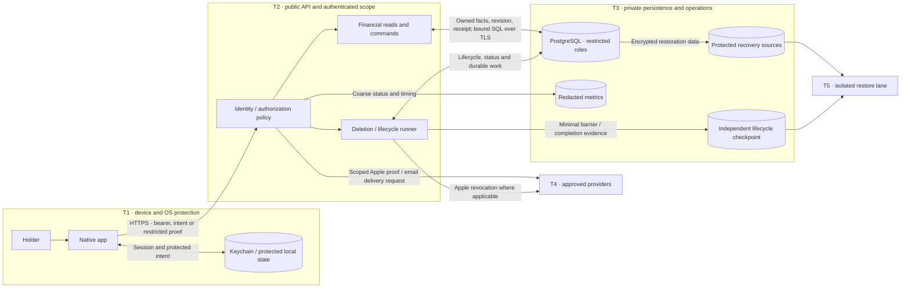
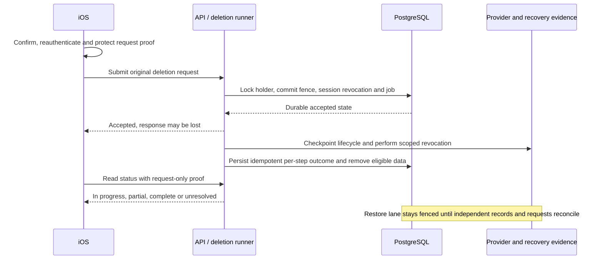

# Security and privacy

## DFD and trust boundaries

T1 separates foreground user authority, suspended app snapshots, and protected device data. T2 validates unauthenticated inputs and authorizes every resource by holder, method, scope and lifecycle. T3 uses independent runtime, migrator and recovery roles and TLS to the database. T4 receives minimum contact or proof only; Apple and email outages are separate. T5 is outside the financial serving path until reconciled. Operational dashboards and diagnostics have their own role and coarse event vocabulary; never include tokens, email addresses, amounts, descriptions, evidence references or financial IDs.

## Defensive threat model

| Risk | Current evidence and individual V0 status | Required control and residual gate |
| --- | --- | --- | --- |
| S1 · Loss of holder isolation or verified-method authority | **Partial; residual open.** Signed bearer authorization, Apple validation and database ownership tuples exist. Email/password verification and a complete shared lifecycle fence are not evidenced. | Permit financial access only from verified email/password or Apple authority, never merge by email, and recheck current holder/session/method under the shared writer barrier. Test two holders and revoked/unverified methods. G02. |
| S2 · Challenge, token or stale-session reuse | **Partial; residual open.** Login/refresh/logout and Apple paths exist. A bounded one-use recovery proof and absolute refresh lifetime are not approved/proven; bearer revocation needs authoritative enforcement. | Consume purpose-bound proof once; contextual reauth ≤5 minutes and recovery proof 15 minutes remain candidate values. Bound refresh idle time to candidate ≤30 days and separately decide absolute expiry. Test refresh races, revocation and same-holder new session. G02/G03. |
| S3 · Cross-owner read, delayed state or local disclosure | **Partial; residual open.** Keychain and protected intent code exist. Source review has identified load/replay and post-suspension scope checks as compatibility concerns; physical lock, logout and holder-switch behavior are not verified. | Keep intent lookup read-only; recheck holder, session generation, environment and target after awaits; clear or isolate local state on logout/environment change. Verify on locked physical device and failed Keychain writes. G04/G06.2. |
| S4 · Duplicate or inconsistent financial effects | **Partial; residual open.** I1–I5 receipt constraints, revisions, base/movement history, single promoted account and a legacy write fence exist. V0 proves selected invariants and one upgrade path; it does not prove a shared holder barrier across every writer or all lost-response races. | Replacement applies only to unresolved intent after durable no-effect proof. A later legitimate operation after a confirmed terminal outcome is a new intent with its own key. Keep anti-duplication evidence outside the receipt-payload window. Prove every writer and both race orders. G03/G04/G05. |
| S5 · Accepted deletion leaves accessible data or restored authority | **Open.** Current OpenAPI/schema contain no coordinated deletion request/status or independent restore checkpoint. | Coordinate holder fence, authority revocation, durable deletion job and scoped status lookup. Restore only after independent evidence and requests reconcile; unknown outcome keeps the environment fenced. Two isolated restore drills. G03/G10. |
| S6 · Disclosure through infrastructure, transport or support | **Open.** Candidate providers are named, but actual hosting, DB role grants, TLS configuration, logs, provider copies, support exports and backups are not verified. | Enforce least privilege, isolate staging credentials, keep secrets out of the app, minimize diagnostic payloads, and verify transport, egress, telemetry and provider retention before promotion. G05/G09/G10. |
| S7 · Unavailable or inconsistent service under load | **Partial; operational residual open.** `/health` reports process health; V0 `/ready` queries PostgreSQL under a 1.5 s statement timeout and a 5 s pool acquisition timeout, and requires the exact schema marker. There is no load result, service-level alert, external provider readiness or recovery drill. | Keep liveness separate and retain bounded timeouts/pools with per-family monitoring. Verify C1/C2, timeout/retry behavior and G09 thresholds with synthetic load. G09. |
| S8 · Build/configuration drift | **Partial; residual open.** `StagingRelease` uses a fixed Bundle ID and endpoint-scoped Keychain service, rejects missing or inconsistent staging configuration, and exposes no transaction/account flow. Accepted V0.1 records a Node 24 Docker build/runtime and isolated Simulator tests; REN01 later adopts `npm ci`, whose Docker image rerun is pending. The artifact is not signed or run on a physical device, and the authorized host and Apple capability remain unverified. | Bind only an authorized staging host and matching identity, verify entitlements/provider sandbox and Release artifact, keep credentials separate, and test on physical iPhone. Do not enable finance flows or promotion from the configuration alone. G05/G06.2. |

Keep Apple identity proof, server session refresh and provider refresh/revocation separate. Recovery proves an existing holder without merging by email. Voluntary unlink requires a usable remaining method at commit; external invalidation can leave zero and block finance. Build and verify capability/entitlements and physical Apple lifecycle in a controlled environment. [Apple account deletion guidance](https://developer.apple.com/support/offering-account-deletion-in-your-app/) · [Apple Keychain accessibility](https://developer.apple.com/documentation/security/ksecattraccessiblewhenunlockedthisdeviceonly).

## Data inventory and candidate retention rules

This inventory distinguishes current stores from intended-but-absent records. Retention values are candidates, not approved operating policy. Confirm legal basis, provider copies, region, deletion exceptions and purge evidence before adoption. The receipt payload may expire after its 30-day candidate replay window only when a separate durable effect/no-effect anchor still prevents duplication.

| Data class / current representation | Purpose and sensitivity | Allowed access / boundary | Retention candidate and current status |
| --- | --- | --- | --- |
| Holder and identity (`users`, `auth_identities`) | Stable user ID, email, password verifier, Apple subject/email and encrypted provider refresh material; personal and restricted. | Auth and identity lifecycle only; no automatic email merge. Provider/service copies must be inventoried. | Keep while account is active; erase identifiers after coordinated deletion outcome. Provider material removed after authorized revocation is confirmed. Current deletion execution is absent. |
| Sessions and credentials (`refresh_sessions`, iOS Keychain) | Hashed refresh token, optional Apple identity link, expiry/revocation; restricted. | Auth/session service and original device. The staging Bundle ID is fixed as `com.ferrari.Fintech.staging`; the staging Keychain service namespace adds the full endpoint and therefore varies by endpoint. Both preserve their existing Apple identifiers pending a compatibility plan. | Expire/revoke by session policy. Candidate refresh idle limit ≤30 days; absolute limit unresolved. Device loss and physical Keychain protection need testing. |
| Accounts, categories and movements (`accounts`, `categories`, `transactions`) | Account label/currency, category label, transaction ID/type/amount/currency/description/time and optional category; sensitive financial records. | Holder-scoped API and database constraints. Legacy records may predate promotion/T0. | Active account life, including required history. Coordinated deletion policy is not implemented; no uploaded receipts exist in the current schema. |
| Opening base and observation (`mvp_accounts`, `mvp_balance_checks`, `mvp_base_versions`) | BRL base, coverage start, zone, revision, check amount/cutoff, calculated difference and base audit; sensitive financial data. | Promoted-account services and narrowly scoped maintenance. | Keep source and required audit while account is active; reconcile and erase under future deletion policy. No final financial retention period is approved. |
| Recovery and correction (`mvp_expense_recoveries`, `mvp_movement_versions`, `mvp_check_replacements`) | Evidence text, optional external reference, declared values, action/reason, original and revised values and check succession; sensitive and potentially identifying. | Account-scoped services and audited support path; external receipt/image is not stored. | Keep with the affected financial history until deletion policy resolves it. Limit evidence to the structured minimum. Current deployment/log copies are unverified. |
| Idempotency and canonical receipt (`idempotency_keys`) | Scoped key, request hash and JSON response may contain personal/financial fields; restricted. | Command handlers, authorized replay reader and database maintenance. | Candidate payload replay: 30 days. Retain compact no-effect/committed anti-duplication evidence independently of that window; the current table does not yet define a separate terminal anchor lifecycle. |
| Protected local intent / proof (`MvpIntentStore`, Keychain) | Frozen command terms, scope and receipt/status handles; sensitive local state. | Original app environment and authenticated holder only; status query must never submit a command. | Keep only as long as necessary to resolve or safely block; delete by scope/environment on confirmed lifecycle transition. Candidate deletion-status proof: 30 days after definitive outcome, while pending requests remain trackable. |
| Recovery/re-auth challenges and deletion status | Intended one-use recovery proof, context-bound reauth, deletion request/status and independent checkpoint. No complete server-side records currently exist for these flows. | Purpose-bound auth, status-only endpoint and restricted recovery operator. | Candidate recovery proof: 15 minutes, single use. Candidate reauth: ≤5 minutes. Candidate deletion lookup: 30 days after definitive outcome. Implement only after policy and recovery design are approved. |
| Telemetry and metrics | Request/application diagnostics and aggregate service/process metrics; actual sink, fields and vendor retention not verified. | Operations on minimized/redacted fields; never require financial payload for ordinary telemetry. | Candidate raw telemetry: 14 days; aggregated metrics: 90 days. Verify both deletion and downstream/vendor copies. |
| Backups, PITR and exports | Copies may contain every database class; providers and configured lifetime are not selected or evidenced. | Recovery-only role and isolated restoration lane. | Candidate synthetic backup retention: 7 days. Inventory every copy, test expiration and block reappearance after restore; do not select a real provider/region here. |

### Critical sequence · deletion and restore

There is a commit-to-checkpoint failure window. A durable outbox in the same restored database cannot, by itself, close it. Candidate policy requires verifiable continuous recovery coverage through the barrier or an independently durable minimal fence record, and forbids serving a restore when recent deletions or accepted effects cannot be reconciled. Require continuity evidence through a conservative coverage watermark or commit position for every restoration source. If a gap can hide a barrier and the affected holders cannot be identified, keep the entire recovered environment unavailable until the scope is bounded and reconciled. Test interruption after deletion commit and before independent checkpoint in addition to two timed drills. Restrict the privileged purge path to the correctly fenced holder and verify by grants tests that the runtime role cannot bypass immutable-history controls. Address restored sessions, provider revocations, local-device deletion and all recovery sources. The deletion proof outlives ordinary session invalidation and grants only the status of its original request. Track incomplete revocation or local disposal distinctly. A terminal status says what was verified, within the approved retention rule.

## Applicable OWASP verification

ASVS v5.0.0 selection is by chapter, MASVS v2.1.0 by control/group. This is a verification map. For an actual assessment record exact numbered requirements, applicability, test artifacts and dispositions for the approved target scope.

| Standard and scope | Current evidence | Required evidence / gates |
| --- | --- | --- |
| ASVS V1/V2/V4 · input, business logic and service | DTOs, OpenAPI, bound SQL and DB constraints present in source | Contract/property tests, scope checking across readers/writers, error contract, amounts and concurrency. G03/G04/G07 |
| ASVS V6/V7/V8/V9/V10 · authentication, session, authorization, tokens, Apple | Auth guard, refresh and Apple integration exist | Method-specific rights, expired/revoked sessions, challenge misuse and account/target negatives. G02/G03 |
| ASVS V11/V12/V13/V14 · cryptography, TLS, configuration and data | Configuration preflight and storage design, operating grants unverified | Verify provider keys/rotation, TLS paths, roles, privacy, logs and backups. G05/G09/G10 |
| ASVS V15/V16 · architecture, logs and errors | Technical docs and process health | Reviewed DFD, dependency policy, denied access and provider faults in redacted traces. G05/G09 |
| MASVS-STORAGE-1/2, CRYPTO-1/2 | Keychain and pending storage are present | Verify attributes, backup/restore behavior, inaccessible Keychain, zero leakage to logs/selector and runtime protections. G04/G06.2 |
| MASVS-AUTH-1/2/3, NETWORK-1 and reviewed NETWORK-2 applicability | Native Apple and URLSession, configuration distinction in source | Physical session, provider and device-auth journey, trusted host/TLS and negative configuration; justify endpoint identity/pinning trade-off. G02/G05/G06.2 |
| MASVS-PLATFORM-1/2/3, CODE-1–4, PRIVACY-1–4 and reviewed RESILIENCE scope | Native UI, tests and explicit build settings; partial coverage | Physical app-switch/role protection, release artifact and dependencies, disclosure, minimization and deletion; confirm which IPC, WebView or additional tamper controls apply. G03/G05/G06.2 |

ASVS V3 browser UI, V5 file handling and V17 WebRTC have no identified user-facing API surface in C+A. Reassess if verification links or uploads introduce application-owned browser/file paths. MASVS applicability is to the actual Release binary. [ASVS v5.0.0 chapters](https://github.com/OWASP/ASVS/tree/v5.0.0/5.0/en) · [MASVS control catalog](https://mas.owasp.org/MASVS/) · [MASVS v2.1.0](https://github.com/OWASP/masvs/releases/tag/v2.1.0).
