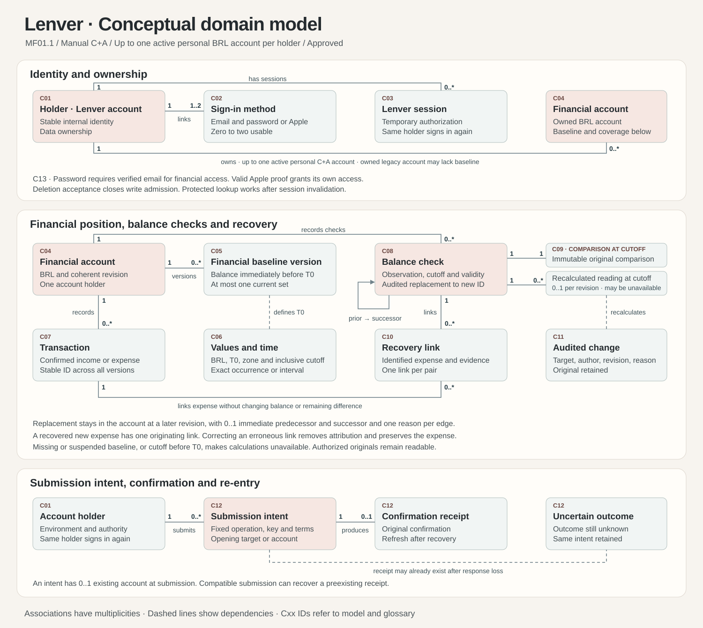

# Approved functional model

Lenver's C+A functional baseline covers one active personal BRL account per account holder. The account holder can continue recording transactions while investigating a balance discrepancy. This is the approved product model. API shapes, persistence, security mechanisms and rollout are specified and verified separately.

| Approval | Canonical material |
| --- | --- |
| MF01.1 · 2026-11-24 · MD-004/006 | [Domain concepts and invariants](#mf011-domain), [bilingual glossary](glossary.md), [decisions and scenarios](functional-scenarios.md) |
| MF02 · 2026-11-24 · MD-007/008 | [Use-case catalog and UML](use-cases.md) |
| MF03.1 v1.0.0 · 2026-11-25 · MD-005/012 | [Behavior, guards, transitions and flows](behavior.md), [traceability and evidence](functional-traceability.md) |

## MF01.1 domain

| ID | Concept | Identity, relationships and responsibility |
| --- | --- | --- |
| C01 | Account holder and Lenver account | One stable internal identity per account holder. The Lenver account is that holder's access, privacy and closure context. A holder may own zero or more financial accounts, at most one active personal account in C+A. |
| C02 | Sign-in method | Every active registration link belongs to one holder. A registered holder has one or two linked methods, password and/or Apple, of which zero to two may be usable. Email identifies contact and password access. Apple's issuer and subject identify the external link, including with a relay address or absent contact. |
| C03 | Lenver session | Temporary authorization for exactly one holder. A holder can have zero or more sessions. Re-entry and credential rotation preserve identity. |
| C04 | Financial account | Stable identity owned by exactly one holder. MVP currency is BRL. Deferral may leave a new holder without an account. An owned legacy account may have history and no baseline. Records that predate ownership controls require proof before adoption. Account revision is scoped to this account. |
| C05 | Financial baseline and versions | An account has zero or more baseline versions and at most one current set of terms. Terms declare the balance immediately before T0, the coverage start and its time zone. Suspension preserves the terms while disabling calculation. |
| C06 | Coverage, occurrence, cutoff and money | Context values. Occurrence is a known instant or a civil-day interval with unknown time. The cutoff is the time reference of an observation. Recording time identifies when a fact was recorded. Money is exact BRL. |
| C07 | Transaction | Stable identity, one account, immutable type and currency. Each account may have zero or more transactions. A fact has one original and zero or more later versions. Amount, occurrence and description can be versioned. Invalidation removes its contribution and preserves identity and history. |
| C08 | Balance check | Each account may have zero or more checks. Each freezes reported balance, cutoff, author and recording time and has exactly one original comparison. Replacement links an earlier check to a new ID in the same account. Each has at most one immediate predecessor and one immediate successor. |
| C09 | Comparison and result at cutoff | One immutable original comparison per check, including zero difference. Zero or more recalculated readings, at most one for the same revision and cutoff. An unavailable reading retains the observation and original with no remaining difference. Current calculated balance uses its own cutoff. |
| C10 | Matching and expense recovery | An audited recovery link joins exactly one check and one expense from the same account, with evidence, author and revision. Each end can have multiple links. One link per pair over its history. Correction evolves that link. An expense created by recovery has one originating recovery link. The same expense may later be linked to other eligible checks. |
| C11 | Audited change and account revision | A change preserves the original and records action, target, author, time, revision and reason when required. A revision identifies a coherent account state. A version identifies a historical state of a fact. Each replacement link retains its own metadata. |
| C12 | Submission intent and confirmation receipt | A protected intent freezes terms, operation, holder, environment and target. It has one holder and zero or one existing account at send time. It produces at most one canonical receipt, and each receipt has one originating intent. Compatible submission using genuine recovery identity can find an existing receipt. The client can be uncertain while a write is confirmed. |
| C13 | Verification, access recovery and deletion | Verification proves email control for password access. Recovery restores access to the same holder. Sign-out ends session authorization. Deletion coordinates account closure, identifiable and local data, sessions and applicable Apple revocation, with a protected result lookup. |

### Relationship diagram

[Open the editable SVG at full size](diagrams/domain-model.svg).

### Invariants

- **I01 · Ownership.** Authorize each operation by demonstrated holder and scope. Financial records, versions, links and receipts share holder and account. Session changes suppress prior holder data and actions. Matching email or submitted identifiers alone confer no ownership. Legacy adoption requires ownership, data integrity and compatibility across all writers. Before proof, leave adoption blocked, preserve records and allow already authorized history without a calculated figure when the baseline is missing.
- **I02 · Access continuity.** Password requires verified email for every financial access including reads, submission lookup and first write. Valid Apple sign-in qualifies for the same holder even if the linked password is unverified. Recover the same identity via verified email, provider or another linked method as applicable. Linking requires consent, proof of both methods and exclusive ownership of the external identity. Matching email never merges holders. Voluntary unlinking must leave another usable method at each commit, including concurrent requests. External revocation is independent and can leave zero usable methods.
- **I03 · Coordinated deletion.** Reauthenticate and confirm explicitly. Distinguish cancellation before confirmation, definitive rejection without effect, accepted work in progress, partial failure and completion. Establish protected authority before transmitting so that only the original deletion can be queried after session invalidation. Response loss keeps the outcome uncertain until proved. Acceptance closes write admission and coordinates competing commits. Already confirmed effects enter deletion scope. An incompatible write cannot acquire authority to commit afterward. Pending intents cannot introduce new effects. Address personal and local data, sessions and applicable Apple revocation. Discard or revocation pending remains distinguishable from completion. Retention requires temporary, minimal, documented justification. Lookup conveys no financial access or cross-holder authority.
- **I04 · Money.** BRL and exact integer cents. A transaction uses 1–999,999,999 cents. Income adds and expense subtracts. Opening and reported balances have separate signed ranges, each including explicit zero. Aggregates and differences can exceed Int64 and require exact representation. Unavailable figures have their own meaning.
- **I05 · Projection and baseline.** For eligible revision r and cutoff c, balance(r,c) = baseline(r) + valid effects occurring in [T0(r), c]. The terms declare the balance immediately before T0. Both limits are inclusive. Current balance uses a separate cutoff. Without an available baseline, suppress affected derived figures and block dependent financial writes. New account and first baseline commit together. Authorized adoption retains IDs and pre-baseline records without counting them in the balance. S06 declares BRL 845 immediately before 2026-11-18 08:00 −03:00.
- **I06 · Contextual precision.** Suggest the current instant, editable, for routine entry and coverage start. Accept a date without time only if all possible instants in the reference zone receive the same classification for each relevant limit. Request enough precision or defer without writing when an interval straddles a limit. A new check has an unambiguous cutoff. Preserve actual precision, short and long civil days, disambiguated repeated times and nonexistent times. Reject a precise future or pre-coverage occurrence on new entry.
- **I07 · Baseline availability and refinement.** Distinguish missing, active and suspended. A cutoff before T0 stays unavailable with active terms. Suspension suppresses derived figures and preserves authorized facts and originals. Baseline correction can restore availability. A changed T0 requires corresponding declaration and coherent preview. Resolve relevant ambiguous intervals before commitment. Refinement fixes occurrence inside the original interval and preserves identity, type, amount and description.
- **I08 · Observation, comparison and replacement.** A balance check creates zero transactions. Original difference = original calculated balance at cutoff − reported balance. Remaining difference in revision r = recalculated balance at the same cutoff − reported balance, when available. A change after cutoff may change only current balance. Correct an erroneous report or cutoff by replacing the check with a new ID and original comparison, using reason, preview and current revision. Preserve the predecessor's originals and links. Edges retain separate authors and reasons, with no cycles or branches and a later creation revision for the successor. A new real observation is independent even at the same cutoff. Eligible evidence can be deliberately associated with a successor without inheriting attribution or duplicating the fact.
- **I09 · Recovery decision.** Similarity only proposes candidates. Deferral preserves figures and history. Human confirmation and identifiable evidence are required even with one candidate. Link at a current calculable check with open discrepancy, including partial explanation, or at a numerical match when the original is nonzero and contribution is provable. An existing expense link changes neither balance nor remaining difference. A distinct eligible recovery expense and its originating link commit together. A mistaken link is corrected with author, reason and revision. Preserve its evidence, identity and legitimate transaction and remove its attribution. When supplied, a genuine source and reference ID identify one fact per account and map to one transaction identity. Compatible repetition can find the original. Incompatible redirection returns to review. Explicit reuse for the same expense in another eligible pair needs its own confirmation. Similar but distinct purchases retain separate identities.
- **I10 · Attribution and historical proof.** Attributed resolution requires a nonzero original difference, zero remaining difference and proved contribution equal to the negative of the original. Other current zeros are numerical matches. An unchanged expense already counted contributes zero. Exclude reclassification from a changed T0. Partial explanation requires the original sign, lower magnitude and contribution toward reduction. A reversed sign remains open. Show validity, availability and classification independently. Indicate reopening only with proof of an attributed zero in the applicable preceding episode of the same check. Distinguish return after a numerical match. With insufficient proof show current classification. A proven link across unavailability preserves the prior episode. Superseded checks are historical even when they have a discrepancy, and authorized history may show originals during unavailability.
- **I11 · Audit, coherence and history reads.** Resolve conflicts with a fresh preview, confirmation and an applicable reason. Effect, monotonic revision, trail and receipt commit together. Search descriptions across the full authorized set and compose period and type filters. The period begins at the inclusive start of the first civil day and ends at the exclusive start of the day following the last, in the account zone. Ordering and tie-breaking are stable, including for day-only occurrences. All pages share compatible scope, filters and revision. A restart retains filters and drops incompatible pages. Track originals by identity and revision.
- **I12 · One logical effect per submission.** Protect original terms and intent identity, holder, environment and target before network use. Protection failure prevents submission. Lookup and eligible explicit resubmission keep the original identity and terms. Release an authorized original receipt before testing fresh-write guards, subject to I03. Incompatible terms conflict. Pre-commit failure leaves effect, trail and revision unchanged. Refresh the authoritative reading separately after commitment.
- **I13 · Outcome and protection.** Distinguish uncertainty, rejection without effect, confirmation, loading, confirmed empty, suspension, unavailability, stale preview and expired session. Editing into a new intent requires definitive proof the uncertain original had no effect. Eligible intent survives voluntary sign-out and resumes only for the same authenticated holder, environment and target. Local loss proves no outcome. Cross-device synchronization is outside MVP. Retention and deletion follow A01. Show an old reading as stale only with proved origin, time, ownership and validity, and suppress invalidated figures. One-use Apple authorization and session refresh have independent lifecycles.

## Scope and implementation evidence

Account-first B opens the Lenver account from the Home toolbar as a native sheet with internal hierarchical navigation. Financial baseline operations belong to the financial account. Open Finance, option B for financial scope, compensating adjustments, category management, multiple active accounts, transfers, Google sign-in, passkeys and a durable offline write queue are beyond the MVP. Existing category data is preserved.

I5 evidence describes the implementation reference. See [authentication](../architecture/authentication.md), [I4 corrections](../architecture/i4-delivery.md), [I5 delivery](../architecture/i5-delivery.md) and [ADR 0006](../adr/0006-mvp-account-revision-and-coverage.md). The signed Int64 ranges for both opening and reported balances run from −9,223,372,036,854,775,808 to 9,223,372,036,854,775,807 cents. I5 uses exact PostgreSQL `numeric` aggregates. Its civil-day representation uses an upper bound before the next civil day, down to the microsecond and bounded by server time where applicable. These are implementation observations. The model defines observable precision and exactness independently. See [implementation differences and open evidence](functional-traceability.md#implementation-and-operational-validation).

| Model concepts | Selected I5 implementation names |
| --- | --- |
| C01–C04, C13 | `users.id`, `auth_identities`, local credential, `refresh_sessions`, `accounts` and `mvp_accounts` serve distinct identity, access and financial roles. |
| C05–C07 | `baseMinor`, `coverageStart`, `amountMinor`, `income` and `expense` identify baseline and transaction terms. |
| C08–C11 | `observedMinor`, original comparison, `calculatedAtReferenceMinor`, `remainingDifferenceMinor`, `status` and `resolutionStatus` are implementation projections. Evidence and optional source references appear as `evidence`, `external_source` and `external_reference`. I5 compares signed contribution under current and original coverage and compares the historical version under original coverage. |
| C11–C12 | Account revision, versions, previews, idempotent writes, canonical receipts and protected intent storage support part of the model. The approved behavior and its open evidence are traced independently. |
